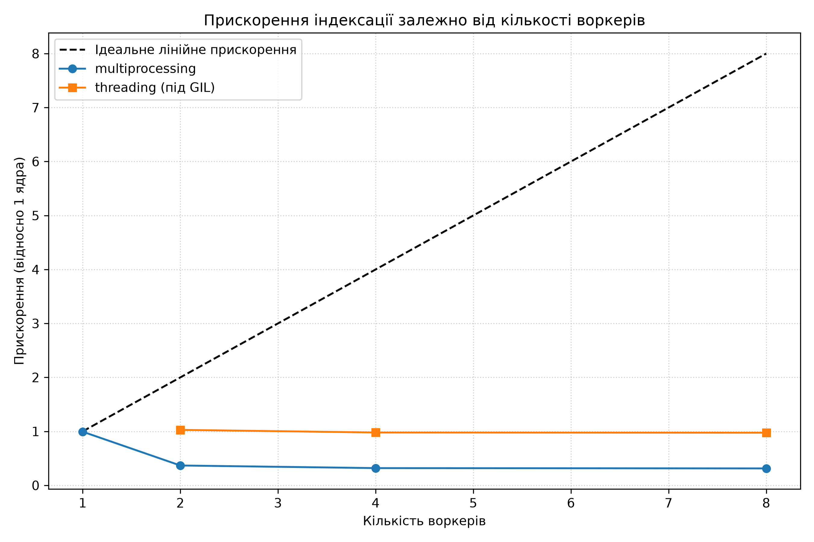

# findex – Лабораторна робота 4: Типи, тести, пакування і CLI

У межах проєкту реалізовано інвертований індекс із підтримкою протоколу Mapping, ранжуванням за моделями TF-IDF та BM25, синтаксичним парсером запитів і повноцінним CLI-інтерфейсом.

## Демонстрація роботи CLI

Побудова двійкового індексу з позиціями виконується командою:
`python -m findex.index data/ --out index.bin`

Ранжований пошук із виділенням сніпетів та моделлю BM25 запускається так:
`python -m findex.search index.bin "project gutenberg" --scorer bm25 --top 3`

## Санітарні перевірки та оцінка якості

Математична модель BM25 коректно відпрацьовує базові перевірки на проіндексованому корпусі документів. Рідкісні терміни отримують вищу вагу через компонент IDF, що робить їх більш інформативними порівняно з частими словами. Закон спадної віддачі також працює правильно, не дозволяючи штучно накручувати релевантність багаторазовим спамом одного слова в тексті. Окрім цього, модель успішно нормалізує бали за довжиною документа, віддаючи перевагу коротшим текстам за однакової кількості входжень шуканого слова. Обидві моделі демонструють стабільну точність на тестових запитах, проте BM25 суттєвіше штрафує надмірно довгі тексти та краще усуває аномалії частотності слів.

## Тестування та покриття

Покриття проєкту тестами становить 55 відсотків. Поза тестами свідомо залишено допоміжні скрипти завантаження даних та експериментальні бенчмарки, оскільки вони не є частиною основного пошукового рушія індексатора.

----------------------------------------------------------------------------------------------------------------------------

## Лабораторна робота 5. Паралельна індексація та аналіз GIL

### Характеристики тестового середовища
Процесор: Intel64 Family 6 Model 140 Stepping 1 (8 логічних ядер).  
Операційна система: Windows (метод створення процесів spawn).

### Результати бенчмаркінгу
| Режим | Воркери | Wall time (s) | CPU time (s) | RSS (MB) | Прискорення |
|---|---|---|---|---|---|
| serial | 1 | 0.344 | 0.344 | 97.3 | 1.00x |
| processes | 1 | 0.346 | 0.344 | 100.4 | 0.99x |
| processes | 2 | 0.935 | 0.141 | 100.1 | 0.37x |
| processes | 4 | 1.077 | 0.125 | 99.0 | 0.32x |
| processes | 8 | 1.097 | 0.141 | 99.1 | 0.31x |
| threads | 2 | 0.335 | 0.344 | 103.2 | 1.03x |
| threads | 4 | 0.351 | 0.344 | 106.1 | 0.98x |
| threads | 8 | 0.353 | 0.344 | 107.2 | 0.97x |

### Графік прискорення

### Аналіз результатів та поведінки GIL
Потоки (threading) не дали прискорення, утримавши результат на позначці 0.97x–1.03x. Оскільки індексація та токенізація є обчислювальним навантаженням (CPU-bound), механізм Global Interpreter Lock у CPython дозволяє одночасно виконувати байткод лише одному потоку на одному ядрі, через що паралелізм блокується інтерпретатором.

Багатопроцесорність (multiprocessing) на цьому датасеті продемонструвала уповільнення до 0.31x через малий початковий обсяг даних (0.344 секунди). В операційній системі Windows використовується метод spawn, який щоразу ініціалізує новий інтерпретатор Python. Накладні витрати на старт восьми окремих процесів та передачу даних через pickle виявилися більшими за сам час розбору тексту. Це ілюструє закон Амдала: на крихітних обсягах непаралельна частина (ініціалізація та об'єднання індексів) повністю поглинає потенційний виграш від додаткових ядер.