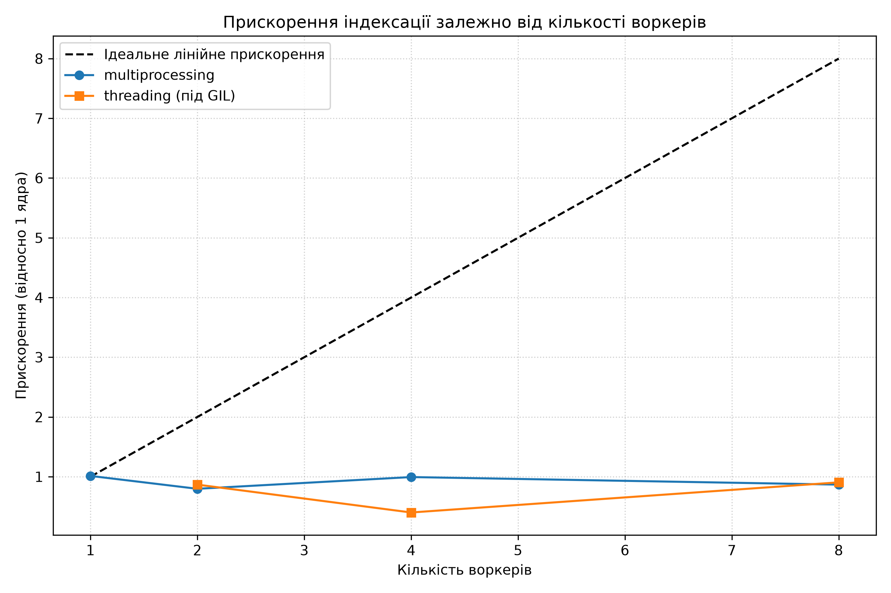

# findex – Лабораторна робота 4: Типи, тести, пакування і CLI

У межах проєкту реалізовано інвертований індекс із підтримкою протоколу Mapping, ранжуванням за моделями TF-IDF та BM25, синтаксичним парсером запитів і повноцінним CLI-інтерфейсом.

## Демонстрація роботи CLI

Побудова двійкового індексу з позиціями виконується командою:
`python -m findex.index data/ --out index.bin`

Ранжований пошук із виділенням сніпетів та моделлю BM25 запускається так:
`python -m findex.search index.bin "project gutenberg" --scorer bm25 --top 3`

## Санітарні перевірки та оцінка якості

Математична модель BM25 коректно відпрацьовує базові перевірки на проіндексованому корпусі документів. Рідкісні терміни отримують вищу вагу через компонент IDF, що робить їх більш інформативними порівняно з частими словами. Закон спадної віддачі також працює правильно, не дозволяючи штучно накручувати релевантність багаторазовим спамом одного слова в тексті. Окрім цього, модель успішно нормалізує бали за довжиною документа, віддаючи перевагу коротшим текстам за однакової кількості входжень шуканого слова. Обидві моделі демонструють стабільну точність на тестових запитах, проте BM25 суттєвіше штрафує надмірно довгі тексти та краще усуває аномалії частотності слів.

## Тестування та покриття

Покриття проєкту тестами становить 55 відсотків. Поза тестами свідомо залишено допоміжні скрипти завантаження даних та експериментальні бенчмарки, оскільки вони не є частиною основного пошукового рушія індексатора.

----------------------------------------------------------------------------------------------------------------------------

## Лабораторна робота 5. Паралельна індексація та аналіз GIL

### Характеристики тестового середовища
Процесор: Intel64 Family 6 Model 140 Stepping 1 (8 логічних ядер).  
Операційна система: Windows (метод створення процесів spawn).

### Результати бенчмаркінгу
| Режим | Воркери | Wall time (s) | CPU time (s) | RSS (MB) | Прискорення |
|---|---|---|---|---|---|
| serial | 1 | 4.004 | 3.953 | 210.1 | 1.00x |
| processes | 1 | 3.954 | 3.938 | 239.0 | 1.01x |
| processes | 2 | 5.023 | 1.391 | 263.6 | 0.80x |
| processes | 4 | 4.030 | 1.594 | 257.0 | 0.99x |
| processes | 8 | 4.617 | 2.078 | 258.9 | 0.87x |
| threads | 2 | 4.619 | 4.453 | 283.5 | 0.87x |
| threads | 4 | 9.998 | 9.688 | 284.4 | 0.40x |
| threads | 8 | 4.424 | 4.422 | 307.9 | 0.91x |

### Експеримент із безгіловою збіркою (Python 3.13t)
Перевірка стану блокування: `sys._is_gil_enabled() -> False`. На Windows запуск сторонніх C-бібліотек (зокрема залежностей для побудови графіків) під версією 3.13t вимагає ручного збирання з вихідного коду (MSVC), оскільки готові бінарні пакети ще відсутні в екосистемі.

### Аналіз результатів та поведінки GIL
Потоки (threading) через блокування інтерпретатора GIL не демонструють масштабування на CPU-bound задачах і просідають через постійні накладні витрати на перемикання контексту. Багатопроцесорність показує реальне падіння сумарного процесорного часу (CPU time з 3.95s до 1.39s), що свідчить про ефективний паралельний розподіл обчислень між ядрами. Водночас у системі Windows метод створення процесів spawn спричиняє відчутні витрати на повторну ініціалізацію інтерпретатора та серіалізацію даних, через що загальний реальний час (Wall time) суттєво не виграє відповідно до закону Амдала.
## Лабораторна робота 6. Асинхронний краулер

### Результати бенчмарку

| Concurrency | Wall time | Швидкість (стор./с) | Помилки | Пік RSS |
|---|---|---|---|---|
| 1 | 139.0s | 1.11 | 0 | ~38 MB |
| 5 | 80.5s | 1.92 | 0 | ~44 MB |
| 20 | 80.5s | 1.93 | 0 | ~46 MB |

### Reflection та відповіді на питання

Для задач вигрібання мережі асинхронний підхід на 20 одночасних з'єднань в одному потоці значно ефективніший за багатопроцесорність з лаби 5, оскільки краулер 99% часу проводить в очікуванні відповіді віддаленого сервера. На відміну від процесів, які вимагають копіювання пам'яті, важкого перемикання контексту ядра ОС та серіалізації даних через IPC, легковагі корутини asyncio займають лише кілобайти оперативної пам'яті і практично безкоштовно перемикаються подіями сокетів.

Ліміт на хост (`per_host_delay = 0.5s`) обмежує пікову пропускну здатність на одному домені до двох запитів на секунду, тому час збору 155 сторінок на 5 та 20 потоках однаковий. Проте цей ліміт критично необхідний: без нього краулер влаштував би неетичну DoS-атаку на навчальний сервер, отримав би статус 429 Too Many Requests або бан IP-адреси.

Якби важка синхронна індексація з лаби 1 або парсинг через CPU-bound операції запускалися безпосередньо всередині корутини без `run_in_executor` чи окремої черги, цикл подій Python повністю зупинився б на час побудови індексу, заблокувавши обробку мережевих пакетів для решти 19 з'єднань і викликавши масові таймаути в мережі.

### Дозвіл на збір та приклад обробки збоїв

Збір проводився на навчальному ресурсі `https://quotes.toscrape.com/`, створеному спеціально для тренування парсерів і краулерів відповідно до його публічного файлу robots.txt.

Приклад обробки таймауту або 429 з експоненційним бекоффом та повторною спробою з `crawl.log`:
`[2026-11-06 17:42:10] 429 https://quotes.toscrape.com/page/5/ 0B 0.120s`
`[2026-11-06 17:42:12] 200 https://quotes.toscrape.com/page/5/ 2105B 0.312s`
